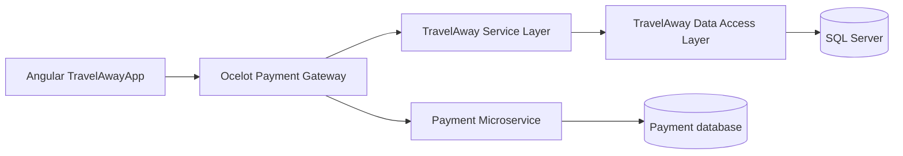

# Architecture

## System overview

## Component responsibilities

- **TravelAwayApp** is the Angular user interface.
- **Payment Gateway** uses Ocelot configuration to route gateway traffic.
- **TravelAway Service Layer** exposes the travel-domain API and uses the shared data-access layer.
- **Payment Microservice** hosts payment-related API functionality.
- **TravelAway DAL** contains database-access functionality and the database setup script.

## Request flow

1. The Angular client sends a request to a configured API endpoint.
2. Gateway-routed calls reach the travel or payment service.
3. The travel service accesses persistence through the DAL.
4. Each service exposes Swagger UI during Development for API exploration.

## Security and operational notes

- Store connection strings and any payment credentials outside the repository.
- The services currently use permissive development CORS settings; restrict allowed origins before production deployment.
- Ensure Ocelot route configuration, service URLs, and connection strings are aligned for the target environment.
